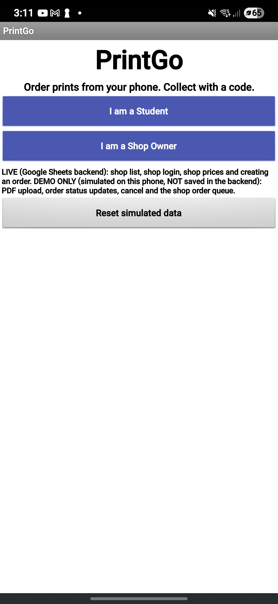
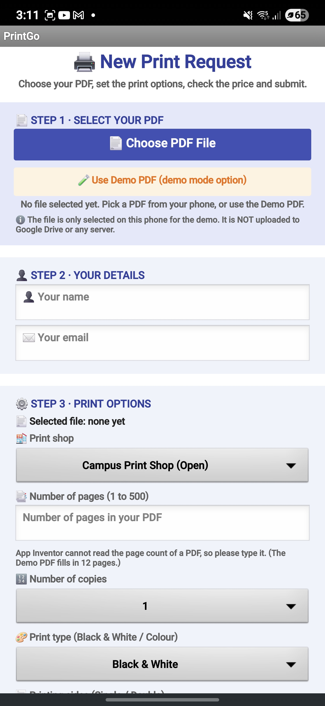
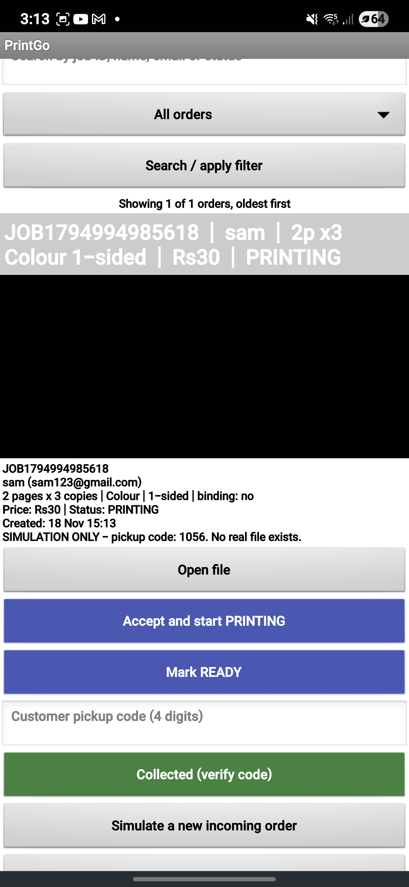
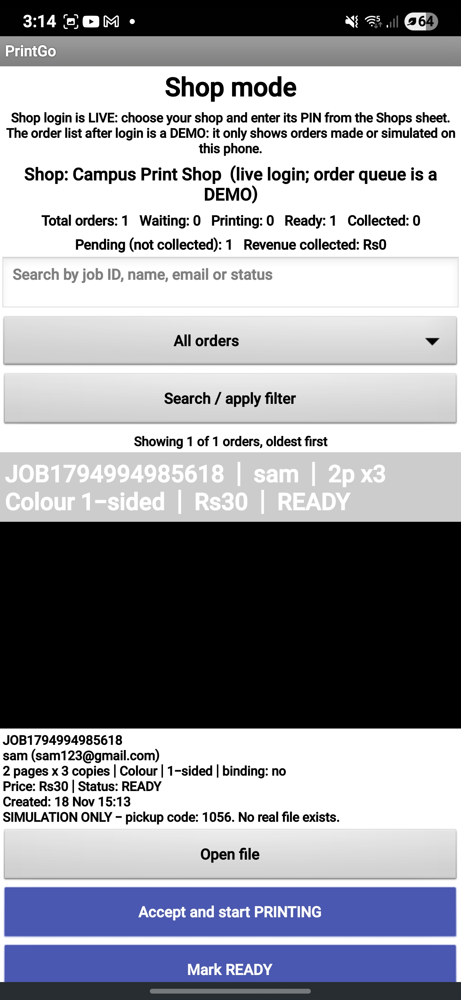
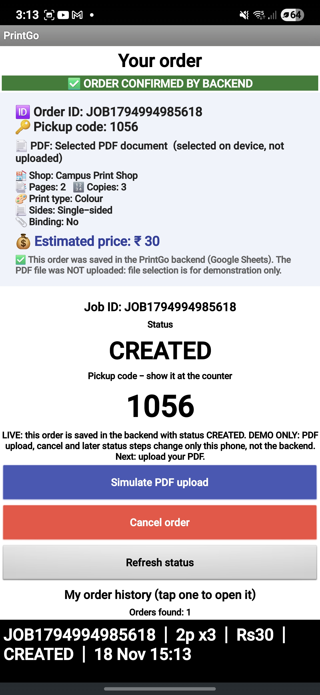

# PrintGo

## Project Overview
PrintGo is a smart campus print queue management system developed using MIT App Inventor. It allows students to submit print requests from their phones while enabling print shop owners to manage incoming orders through a simple dashboard. The system uses Google Sheets as the database and Google Apps Script as the backend. Historical print data is analyzed using Flourish visualizations and AI-generated insights to estimate waiting time and recommend less busy printing hours.

---

## Problem Statement
Students often face long queues during assignment submissions and have no idea about printer availability or waiting time. PrintGo aims to solve this problem by digitizing the print request process, ensuring efficient queue management and an organized workflow for both students and print shops.

---

## Target Users
- Students
- Campus Print Shop Owners

---

## Key Features
- Mobile-based print request submission
- Print shop selection
- Print cost estimation
- Unique pickup code generation
- Order tracking
- Print owner dashboard
- Queue estimation
- Busy hour recommendations
- Google Sheets backend
- Google Apps Script API

---

## Application Screenshots

### Home Screen

### Student Print Request Screen

### Order Confirmation Screen

### Shop Owner Dashboard

### Order Verification Screen

---

## Technology Stack
- MIT App Inventor
- Google Apps Script
- Google Sheets
- Microsoft Excel
- Flourish Studio
- Google Gemini API

---

## Data Analysis & Visualizations
The dataset contains over 100 print records which were cleaned in Microsoft Excel before generating visualizations in Flourish.

### Flourish Story
https://public.flourish.studio/story/3856525/

### Heatmap
https://public.flourish.studio/visualisation/30880973/

### Bar Chart
https://public.flourish.studio/visualisation/30880974/

### Line Chart
https://public.flourish.studio/visualisation/30880975/

### Revenue Distribution Chart
https://public.flourish.studio/visualisation/30885794/

---

## Live Backend (Google Apps Script)
https://script.google.com/macros/s/AKfycbwK3-uz3uFmbmYBp35POyrMOrFcom-goYAbuczc7qTfcY2uemZC21B99zKtV6ly1XxG/exec

---

## Google Sheets Database
https://docs.google.com/spreadsheets/d/1kYJAzYE_GlmIYCklowqx-iqRj2njzrEe/edit

---

## Team Members & Responsibilities

**Samarth Kulshrestha (25ETIM43)**
- Dataset preparation
- Excel data cleaning
- Database management

**Boddeda Lalitha Gowri (25MCCE09)**
- GenAI prompt engineering
- AI enhancement recommendations

**Aditi C B (25ETIM42)**
- Flourish dashboard
- Data visualizations

**Banoth Naveen (25ETIM14)**
- Excel verification
- Data validation

---

## Project Workspace (Google Drive)
All project files, assets, and documentation are available in the shared Drive folder:
https://drive.google.com/drive/folders/1bDFgmHBdF_-ny425-gekB2s9NkZ2nv_1?usp=sharing

---

## GitHub Repository
https://github.com/sam-exec/print-go

---

## Future Improvements
- Real PDF upload to Google Drive
- Push notifications
- Authentication
- Online payment integration
- Multi-campus deployment
